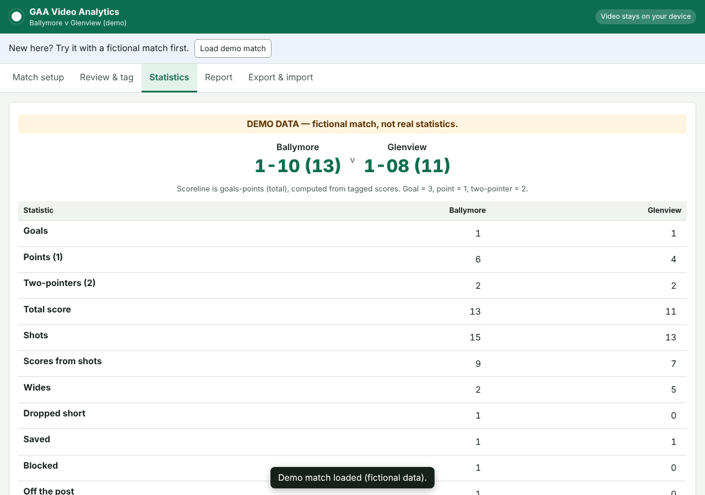

# GAA Video Analytics

Free, open-source match analysis for **Gaelic football**, built for grassroots clubs,
coaches and volunteer analysts.

Load a match video (for example a Veo MP4 export), tag events against the video, review
computer-vision suggestions, and produce a GAA statistics dashboard, a printable match
report (PDF via the browser) and CSV/JSON exports. Every statistic links back to the
tagged events behind it.

- **Web app (GitHub Pages):** runs entirely in your browser. Your video is never uploaded.
- **Local CV processor (optional, Python):** detects and tracks players, groups them by
  jersey colour, finds the visible ball and proposes *candidate* moments for review.

> **Honesty principle.** The software never invents statistics. Scores, shots,
> kick-outs and turnovers come from events a person has tagged or confirmed.
> Computer-vision output stays a *suggestion* until someone accepts it. A category
> you have not fully tagged is shown as **unknown**, not as zero.



## What it does today (v0.1.0)

| Capability | How | Status |
|---|---|---|
| Final score: goals, points, two-pointers (40m arc) | Human-tagged events + GAA rules engine | ✅ Working, unit-tested |
| Shots, scores, wides, short, saved, blocked, post, accuracy, shots by type | Human-tagged | ✅ |
| Kick-outs won/lost, short/long, retention % | Human-tagged | ✅ |
| Turnovers won/conceded, frees won, cards | Human-tagged | ✅ |
| Timeline with running score, timestamped video evidence | Computed from events | ✅ |
| Printable match report (Save as PDF), CSV and JSON export/import | Browser | ✅ |
| Player detection and tracking | YOLOX (ONNX) + ByteTrack, local Python | ✅ Real inference, checked on real pedestrian and basketball footage; not yet measured on Gaelic football footage ([details](docs/research/test-footage.md)) |
| Single-frame person detection in the browser | YOLOX-nano via onnxruntime-web (WASM), self-hosted | ⚠️ Experimental: about 0.2 s per frame, detection only |
| Team grouping by jersey colour | Colour clustering (k-means) | ⚠️ Inferred; you map cluster A/B to home/away |
| Visible-ball detection | YOLOX COCO "sports ball" class | ⚠️ Inferred; unreliable on wide shots of a small ball |
| Possession-change candidates | Nearest player to ball heuristic | ⚠️ Experimental suggestions only |
| Automatic shot / score / kick-out recognition | — | ❌ Not implemented; tag these yourself |
| Pitch calibration, shot locations, heatmaps | — | ❌ Not implemented |
| Player identification (numbers, names) | — | ❌ Not implemented; type the player label yourself |

### Automated vs. human-tagged statistics

**Every statistic in the dashboard and report comes from human-tagged or human-verified
events.** The CV processor produces evidence, such as detections, tracks, colour clusters
and candidate timestamps, to speed up review. It does not produce match statistics. Each
event carries provenance (`manual` or `cv`; `observed`, `inferred`, `verified` or `unknown`),
and the report says how many events came from each source.

## Quick start (web app)

1. Open the GitHub Pages site, or run it locally:
   ```bash
   cd web
   npm ci
   npm run dev
   ```
2. **Match setup:** choose the video file, enter team names and tick the categories you will
   tag fully. Click **Load demo match** to see a filled-in example. The demo match is
   fictional and labelled as such.
3. **Review & tag:** play the video and press the event buttons. Each tag records the
   current video time. Click any event to jump back to it.
4. **Statistics / Report:** click any number to see the events behind it. To get a PDF, use
   **Print / Save as PDF**.
5. **Export:** JSON (the full, re-importable match file), events CSV and stats CSV.

Your work autosaves in the browser (localStorage). The video is not stored, so you need to
re-open the video file after a reload.

### Keyboard shortcuts
`Space` play/pause · `←/→` ±2 s · `Shift+←/→` ±10 s · `,` / `.` frame step

## Optional: local computer-vision processor

```bash
cd processor
python -m venv .venv && source .venv/bin/activate
pip install -e '.[dev]'
python scripts/download_models.py            # YOLOX ONNX weights (Apache-2.0), not committed
python -m gaa_cv analyse match.mp4 --out match.analysis.json \
    --tracks match.tracks.csv --annotate match.annotated.mp4 --profile veo --home "Ballymore" --away "Glenview"
python -m pytest -q
```

Then, in the web app, open **CV candidates → Import analysis** and choose `match.analysis.json`.
See [processor/README.md](processor/README.md) for options and the capability table.

Veo is an *input profile*, not a dependency. A Veo export, a phone video and a fixed-camera
MP4 all go through the same pipeline.

## Architecture

```
 MP4 (Veo / phone / fixed) ──► processor/ (Python, local, optional)
                                VideoSource → Detector (YOLOX ONNX) → Tracker (ByteTrack)
                                → TeamClassifier (jersey colour) → EventExtractor (candidates)
                                └─► analysis.json  (schema/analysis.schema.json)
                                          │
 Browser (GitHub Pages) ◄─────────────────┘
   video player + tagging ─► events (with provenance) ─► web/src/core
                                SportRules (GAA 2025/26) → computeStats → report / CSV / JSON
```

- **Contract:** `schema/analysis.schema.json` = `web/src/core/types.ts`. JSON is the
  interface between the CV processor, the annotation UI and reporting.
- **Rules:** `web/src/core/rules.ts`. Goal = 3, point = 1, a score kicked from outside the
  40m arc = 2 (GAA rules effective 1 January 2026). Rule checks produce warnings, for
  example "two-pointer from inside the arc"; they never silently change your data. See
  [docs/research/gaa-rules.md](docs/research/gaa-rules.md).
- **Stats engine:** `web/src/core/stats.ts`. This is pure TypeScript with every value
  carrying its evidence event ids. Values are `null` (unknown) when a category is not
  declared fully tagged.

## Limitations (please read)

- **No automatic event recognition.** Detecting players is not the same as recognising a
  point, a wide or a kick-out. This version does not recognise those, so a person tags them.
- **Team clustering** assumes two clearly different jersey colours. Goalkeepers, referees,
  similar kits, shadows and Veo's wide-angle distortion all reduce accuracy.
- **Ball detection** uses a general COCO model. A Gaelic football at Veo's panoramic
  resolution is often only a few pixels wide, so expect many missed detections. Possession
  candidates are therefore sparse and low-confidence.
- **No pitch calibration.** There are no real-world positions, distances, speeds, shot
  maps or heatmaps. The `outsideArc` flag is a human judgement.
- **The two-point rule details** for 45s, fisted scores and ladies' football are not fully
  confirmed (see the research notes). The app warns rather than enforcing.
- **CV processing is offline and CPU-bound.** Expect it to run slower than real time on a
  laptop. Use `--stride` and `--max-seconds`.
- The in-browser detector, where available, runs on a single paused frame only.
- **Not yet benchmarked on Gaelic football footage.** No openly licensed GAA clip could be downloaded during development. Detection quality on Veo panoramas is unmeasured.
- Track IDs fragment under occlusion: one person can receive several IDs.

## Roadmap

1. Manual 4-point pitch calibration (homography) → shot locations, arc inference, zones.
2. A GAA-specific detector fine-tuned on openly licensed, consented footage (ball,
   goalkeeper, referee classes).
3. Kick-out and score candidate detection from restarts, ball trajectory and umpire flags.
4. Multi-camera and phone-video profiles (stabilisation, rolling shutter); hurling and camogie
   rulesets via `SportRules`; LGFA rules.
5. Player-level stats with jersey-number OCR, always human-confirmed.

## Licences

This project is licensed under Apache-2.0 (see [LICENSE](LICENSE) and [NOTICE](NOTICE)).
Third-party components:

- YOLOX code and released weights: Apache-2.0 (Megvii). The weights are downloaded, not
  committed.
- supervision: MIT. OpenCV: Apache-2.0. ONNX Runtime: MIT.
- Ultralytics YOLO is AGPL-3.0 and is deliberately **not** used.

No match footage is committed. Test clips are downloaded by script from Wikimedia Commons,
with their licence recorded (see [docs/research/test-footage.md](docs/research/test-footage.md)).

## Research

- [Open-source sports CV projects reviewed](docs/research/cv-projects.md)
- [GAA rules and stat definitions](docs/research/gaa-rules.md)
- [Real-footage test results](docs/research/test-footage.md)

Contributions are welcome, especially openly licensed GAA footage with consent, and
analysts' stat definitions.
